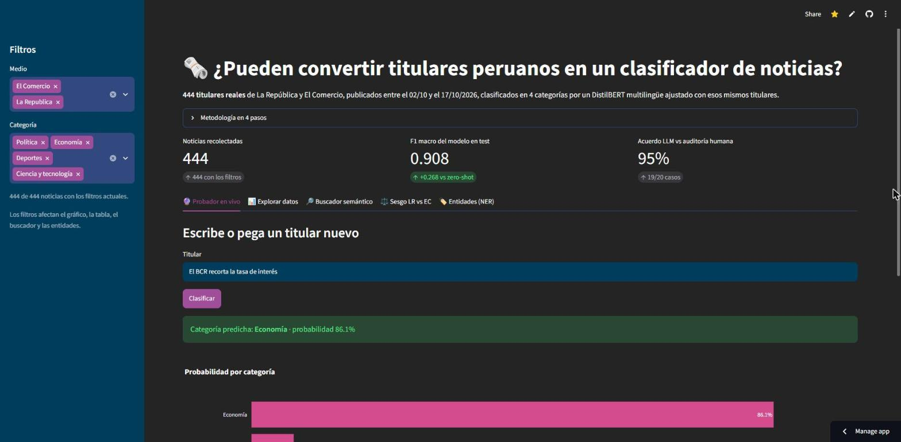

# Tarea 1 – Noticias peruanas: del titular al clasificador

> **Pregunta guía:** ¿Pueden convertir titulares peruanos en un clasificador de noticias?

**Respuesta corta: sí.** Se ajustó un DistilBERT multilingüe con 310 titulares de La República y El Comercio. En
test clasifica en 4 categorías (`politica`, `economia`, `deportes`, `ciencia_tecnologia`) con un **F1 macro de
0.908**:

- iguala a un LLM (0.909), pero es unas 60 veces más rápido y funciona sin internet;
- supera con holgura a un zero-shot (0.640).

| | |
| :--- | :--- |
| **Autor** | Rodrigo Andrés Norabuena Mascaraqui ([@rodnm](https://github.com/rodnm)) |
| **Curso** | Python Intermedio · Diplomatura de especialización Ciencia de Datos para las Ciencias Sociales y la Gestión Pública 2026 |
| **App desplegada** | <https://del-titular-al-clasificador-rodnm.streamlit.app> |
| **Modelo publicado** | [`rodnm/distilbert-noticias-peru`](https://huggingface.co/rodnm/distilbert-noticias-peru) |
| **Video** | _pendiente_ |
| **Medio** | Opción C – Comparada (La República + El Comercio) |



---

## 1. Cómo ejecutar en local

Requiere Python 3.12.

```bash
git clone https://github.com/rodnm/intermediate-python-hw.git
cd intermediate-python-hw
python -m venv .venv
.venv\Scripts\activate            # Windows  ·  en macOS/Linux: source .venv/bin/activate
pip install -r tarea_1/requirements.txt
streamlit run tarea_1/app.py
```

La app se abre en <http://localhost:8501>. Se ejecuta desde la raíz del repositorio porque ahí está el tema
(`.streamlit/config.toml`), igual que en Streamlit Community Cloud. También funciona desde `tarea_1/` con
`streamlit run app.py`, pero con el tema por defecto de Streamlit.

Los pesos del modelo (517 MB) no están en Git porque superan el límite de 100 MB de GitHub. La primera vez que se
usan el probador y el buscador, la app descarga sus modelos del Hugging Face Hub, así que esa primera consulta puede
tardar unos minutos.

**Despliegue.** La app corre en Streamlit Community Cloud con Python 3.12. En Linux, `requirements.txt` instala la
versión CPU de `torch` (192 MB) en lugar de la de PyPI, que arrastra varios GB de CUDA. Con los dos modelos
cargados, la app usa alrededor de 1.2 GB de RAM (medido en local).

**Para reproducir los notebooks**, se ejecutan en orden (`01` → `02` → `03`). No hace falta ninguna API key:

| Notebook | Qué hace | Para ejecutarlo de nuevo |
| :--- | :--- | :--- |
| [`01_recoleccion.ipynb`](01_recoleccion.ipynb) | Scraping, limpieza, mapeo de secciones y EDA | Usa el respaldo `datos/raw/articulos_crudos.csv`. `RE_SCRAPE = True` vuelve a descargar todo |
| [`02_clasificacion.ipynb`](02_clasificacion.ipynb) | Split, zero-shot, LLM, auditoría, fine-tuning y comparativa | Las respuestas del LLM están en caché (`datos/raw/llm_respuestas.jsonl`). Entrena en CPU y guarda los pesos en `modelo/` |
| [`03_innovacion.ipynb`](03_innovacion.ipynb) | Bonus: embeddings, NER y sesgo LR vs EC | Lee la revisión manual de pares de `datos/pares_revision.csv` |

## 2. Medios y fechas de extracción

| | La República | El Comercio |
| :--- | :--- | :--- |
| **Fuente** | RSS, news sitemaps y portadas como semillas, más el rastreo de los enlaces relacionados de cada nota | Sitemaps por sección (`politica`, `economia`, `deporte-total`, `tecnologia`) |
| **Publicación de las notas** | 02/10/2026 – 17/10/2026 | 06/10/2026 – 17/10/2026 |
| **Extracción** | 17/10/2026 | 17/10/2026 |
| **Noticias** | 219 | 225 |

Quedan **444 noticias**, con estas columnas: `medio`, `fecha`, `seccion_original`, `titular`, `bajada`, `url` y
`etiqueta`. Por categoría:

| | Política | Economía | Deportes | Ciencia y tecnología |
| :--- | :---: | :---: | :---: | :---: |
| La República | 60 | 47 | 52 | 60 |
| El Comercio | 58 | 52 | 59 | 56 |

**Scraping respetuoso:**

- Cada URL se valida contra `robots.txt` con `protego`, que entiende los comodines que usa La República.
- Hay una pausa de 1–2 s entre peticiones y un `User-Agent` que identifica el proyecto.
- Cada petición queda registrada en `datos/raw/log_peticiones.csv`.

La paginación de La República está prohibida en su `robots.txt`. Por eso el volumen se consiguió siguiendo enlaces
relacionados, nunca paginando.

## 3. Hallazgos

**1. Un modelo pequeño ajustado iguala al LLM, y su punto débil es economía.**

- El DistilBERT ajustado iguala al LLM en test: 0.908 contra 0.909.
- Responde en 23 ms por titular contra 1461 ms del LLM. Además es gratis y funciona sin conexión.
- Deportes es perfecto (F1 1.000). **Economía es la categoría más difícil** (F1 0.828) porque comparte actores
  estatales con política. 3 de los 6 errores confunden ambas categorías en titulares sobre un ministerio: Trabajo,
  Mincetur y Minas.
- El modelo funciona mejor con La República (F1 0.968) que con El Comercio (0.849): 5 de sus 6 errores son
  titulares de El Comercio.

**2. Los dos diarios clasifican igual la misma noticia, pero no la titulan igual.**

- De 30 candidatos emparejados por similitud, la revisión manual confirmó 19 pares sobre el mismo hecho.
- En 18 de los 19 coinciden la sección editorial y la predicción del modelo.
- La excepción es el cáncer del papa León XIV, una cuestión de encuadre:
  - La República lo publicó en política ("Vaticano informa que…").
  - El Comercio lo publicó en ciencias ("qué implica la extirpación de un lóbulo…").
  - El modelo siguió ese encuadre en ambos casos.
- En estilo, **El Comercio titula con preguntas seis veces más que La República** (14.2 % contra 2.3 % de sus
  titulares). Es el formato del periodismo explicativo: "¿Cuáles serán las prioridades de su agenda?".

## 4. Limitaciones

**1. Una frase que el modelo nunca vio puede engañarlo con confianza alta.**

| Titular | Predicción |
| :--- | :--- |
| "BCR mantiene su tasa de referencia **por tercer mes consecutivo**" | `deportes` (0.74) ❌ |
| "BCR mantiene su tasa de referencia en 4,25 %" | `economia` (0.88) ✅ |

"Tercer" y "consecutivo" no aparecen en ningún titular de entrenamiento. Frente a esa frase, el modelo la asocia
con las rachas deportivas. Como la confianza (0.74) supera el umbral de 0.6, la app **no muestra la advertencia de
baja confianza**: una probabilidad alta no garantiza un acierto.

**2. Pocos datos y una ventana corta.**

- **Test pequeño:** tiene 67 titulares, así que cada titular mal clasificado mueve el accuracy 1.5 puntos.
- **Ventana corta:** los datos cubren dos semanas de octubre de 2026. Con otros temas en agenda, por ejemplo en
  plena campaña electoral, el modelo puede rendir peor.
- **Muestra no aleatoria de La República:** salió del rastreo de enlaces relacionados, que favorece los temas que
  el propio diario enlaza entre sí.

## Resultados

Todos los enfoques se evaluaron sobre el mismo test, que no se usó para entrenar ni para elegir el modelo.

| Enfoque | Evaluado sobre | Accuracy | F1 macro | Latencia | Costo | Internet |
| :--- | :--- | :---: | :---: | :---: | :--- | :--- |
| Zero-shot (`Recognai/bert-base-spanish-wwm-cased-xnli`) | 40 titulares del test | 0.675 | 0.640 | 194 ms | Gratis | Solo para descargar |
| LLM débil (`gemini-3.8-flash`, titular + bajada) | test (67) | 0.910 | 0.909 | 1461 ms | API por llamada | En cada predicción |
| **DistilBERT fine-tuned (etiqueta editorial)** | test (67) | **0.910** | **0.908** | **23 ms** | Gratis | Solo para descargar |
| DistilBERT fine-tuned (etiqueta del LLM) | test (67) | 0.851 | 0.848 | 23 ms | Gratis + etiquetado | Solo para descargar |

- **Auditoría del LLM:** la etiqueta del LLM coincide con la sección editorial en el 95.7 % del dataset. En una
  auditoría humana a ciegas de 20 casos coincidió en **19 de 20**.
- **Verificación de la extracción:** después de etiquetar, se comprobó contra la web que el titular y la bajada
  estuvieran bien extraídos (20/20).
- **Una falla encontrada:** la auditoría detectó una subsección de El Comercio fuera de las 4 categorías,
  `tecnologia/streamers`. Se excluyó en la limpieza del notebook 01.
- **Modelo para producción:** el fine-tuned. Rinde igual que el LLM a una fracción del costo y la latencia, y el
  LLM queda como etiquetador.

## Bonus

| Idea | Dónde | Resultado |
| :--- | :--- | :--- |
| **Sesgo comparativo LR vs EC** | Notebook 03 · pestaña ⚖️ | 19 pares confirmados a mano. Hallazgo 2 |
| **Buscador semántico** | Notebook 03 · pestaña 🔎 | Embeddings `intfloat/multilingual-e5-small`. El 89.7 % de los vecinos más cercanos son de la misma categoría |
| **NER peruano** | Notebook 03 · pestaña 🏷️ | `mrm8488/bert-spanish-cased-finetuned-ner`: 1515 menciones de 876 entidades, por categoría y por medio |
| **Video demostrativo** | _pendiente_ | |

## Dashboard (`app.py`)

- **Filtros:** medio y categoría en la barra lateral. Afectan el gráfico, la tabla, el buscador y las entidades.
- **Indicadores:** total de noticias, F1 macro en test y acuerdo LLM-humano. Se leen de `modelo/metricas.json`,
  sin cifras escritas a mano.
- **Datos:** un gráfico Plotly de categorías por medio y una tabla con descarga en CSV.
- **Probador en vivo:** devuelve la categoría y la probabilidad de cada una de las 4. Muestra una advertencia si la
  confianza es menor que 0.6.
- **Diseño:** paleta [Catppuccin Mocha](https://catppuccin.com/palette/), la misma de los gráficos de los notebooks.
  - **Medios:** amarillo para El Comercio y rojo para La República, validados para que se distingan también con
    daltonismo.
  - **Acento:** mauve, para que la interfaz no se asocie con ninguno de los dos diarios.
  - **Botón "Clasificar":** es secundario. Streamlit pinta en blanco el texto del botón primario, y sobre los acentos
    pastel de Catppuccin ese texto casi no se lee (contraste de 2:1).

## Estructura

```text
tarea_1/
├── 01_recoleccion.ipynb      # Scraping, limpieza y EDA
├── 02_clasificacion.ipynb    # Zero-shot, LLM, auditoría, fine-tuning y comparativa
├── 03_innovacion.ipynb       # Bonus: embeddings, NER y sesgo LR vs EC
├── app.py                    # Dashboard Streamlit
├── paleta.py                 # Paleta Catppuccin Mocha compartida por el dashboard y los notebooks
├── requirements.txt          # Versiones exactas
├── img/dashboard.jpg         # Captura del dashboard desplegado
├── datos/
│   ├── noticias.csv          # 444 noticias, 7 columnas
│   ├── etiquetas_llm.csv     # Etiquetas del LLM para todo el dataset
│   ├── auditoria_llm.csv     # 20 casos auditados a ciegas
│   ├── split.csv             # Partición train/val/test reproducible
│   ├── pares_revision.csv    # 30 candidatos LR–EC con la revisión manual
│   ├── pares_sesgo.csv       # 19 pares confirmados con predicciones
│   ├── ner_entidades.csv     # Entidades por noticia
│   ├── embeddings.npy        # 444 × 384
│   └── raw/                  # Sitemaps, feeds, respaldo crudo, caché del LLM y log de peticiones
└── modelo/                   # Configuración, tokenizer y métricas (los pesos están en el Hub)
```

## Bitácora

| Parte | Issue | Pull request |
| :--- | :--- | :--- |
| Recolección y limpieza | [#1](https://github.com/rodnm/intermediate-python-hw/issues/1) | [#4](https://github.com/rodnm/intermediate-python-hw/pull/4) |
| Modelado y clasificación | [#2](https://github.com/rodnm/intermediate-python-hw/issues/2) | [#5](https://github.com/rodnm/intermediate-python-hw/pull/5) |
| Dashboard y despliegue | [#3](https://github.com/rodnm/intermediate-python-hw/issues/3) | [#6](https://github.com/rodnm/intermediate-python-hw/pull/6) |
